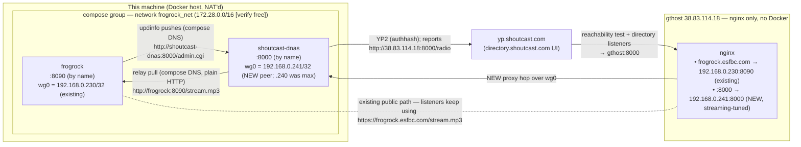

# FrogRock ↔ Shoutcast Directory — Integration Plan

Goal: list FrogRock in the Shoutcast directory (YP) using a **genuine, unmodified
SHOUTcast DNAS v2** instance, while guaranteeing that **any Shoutcast-side failure
never takes FrogRock down**. Exploit FrogRock's actual features (live ICY metadata,
`/api/status`, track/channel data, web player) for a richer listing than the
generic tutorial produces.

**Topology (revised):** DNAS runs **on this machine** in a new container group
alongside FrogRock (its own compose network, containers speak by name). The VPS
(`gthost`, 38.83.114.18) stays an **nginx-only edge** — no Docker on it. The YP
directory and directory listeners reach DNAS through a new nginx server block on
`gthost:8000` that proxies over the existing WireGuard mesh.

> Verified against: DNAS 2.6.1 build 777 changelog (2022-01-30, final release),
> official DNAS config reference (sc-mirror.shoutca.st), this repo's `server.ts`,
> the DrivePod cache, live `ip addr` output from the frogrock container
> (eth0 = docker bridge 172.20.0.2/16, wg0 = 192.168.0.230/32), and a
> 2026-09-07 live recon on gthost (`/etc/wireguard/wg0.conf`, nginx conf.d,
> no ufw). Items marked
> **[verify]** must be confirmed in Phase 0/4/5 because they depend on live
> behavior or on `gthost`.

**gthost access pattern** (used throughout):
```bash
ssh -i ~/.ssh/gthost_rsa -p 46914 root@38.83.114.18 '<remote command>'
```

---

## As-Built (2026-09-07) — what shipped vs. the plan below

The plan below is the design record. Execution deviated on the points below;
**these notes override the plan where they conflict.**

**1. New `stream-fix` shim container (not in the original plan).** DNAS 2.6.1's
relay client (Ultravox/2.1) emits a header whose *name* contains spaces
(`Ultravox transport type:TCP`). Verified byte-for-byte against nginx 1.26.3
(gthost) and Node/llhttp (frogrock): **both reject a header name that is not a
single token with 400** — every other quirk (no space after the colon, e.g.
`Host:value`) is tolerated by both. Since no strict frontend accepts DNAS's
framing as-is, the relay now transits a small Python TCP filter
(`dnas/stream-fix/`) that (a) rewrites that one header to a valid token and
(b) downgrades the request to HTTP/1.0 so Node answers close-delimited instead
of `Transfer-Encoding: chunked` (unparseable by the vintage ICY client). All
other bytes pass through verbatim. Relay URL: `http://stream-fix:8091/stream.mp3`
(compose name) / `http://127.0.0.1:18301/stream.mp3` (loopback publish, host-side
manual test).

**2. `portbase=8100`, not 8000.** Host port 8000 is taken here and no host ports
are published at all. The gthost `:8000` block proxies to `192.168.0.241:8100`.
Public URL for YP/listeners is unchanged: `http://38.83.114.18:8000/radio`.

**3. Subnet `172.35.0.0/16`, not 172.28.** 172.17–172.34 were all in use.

**4. Pinned container IPs + exact-IP adminfile.** DNAS 2.6.1's `adminfile`
accepts **exact IPv4 only** (no CIDR, no wildcards — `172.35.0.0/16`,
`172.35.*.*`, and `0.0.0.0/0` are all rejected as "bad IP"). So `ipv4_address`
is pinned: frogrock=`172.35.0.10`, shoutcast-dnas=`172.35.0.20`,
stream-fix=`172.35.0.30`. `sc_serv.admin` = `127.0.0.1` + `172.35.0.10`.

**5. `destip` dropped.** `destip` is the listener *binding* address;
`38.83.114.18` is not local, so DNAS tried to bind it, logged a WARN, and
fell back to 0.0.0.0. The docs make `publicip` the correct knob for the public
listing (no binding effect). Config = `publicip=38.83.114.18` + `publicport=8000`,
no `destip`.

**6. `updinfo` / `shoutcast-updates.ts` not needed (FrogRock integration phase
dropped).** FrogRock's ICY UA whitelist matches the relay's UA (`Ultravox/2.1
Shoutcast Server 2.6.1.777 Relay` contains "Shoutcast"), so FrogRock sends full
ICY `StreamTitle` metadata and the DNAS relay forwards it to listeners and YP.
Titles flow automatically — no code change, no FrogRock image rebuild/redeploy.
(A manual `admin.cgi?mode=updinfo` still works but is overwritten by the relay's
own metadata within ~2 s, proving the relay metadata is the active source.)

**7. FrogRock attached to `frogrock_net` — declarative in compose
(2026-09-09).** Originally attached ad hoc via
`docker network connect --ip 172.35.0.10 frogrock_frogrock_net frogrock`
(additive, no restart; keeps 172.20.0.2 on its default net). Pitfall found:
any `docker compose up -d frogrock` **recreate silently detaches** that
manual connection — DNAS's relay then loses its source and the YP URL
answers 401 "currently unavailable" (DNAS's no-stream response) while the
frogrock stream itself is fine. Fix: the attachment is now declared on the
frogrock compose service (`networks: frogrock_net: ipv4_address: 172.35.0.10`),
so recreates converge on the same two-network state (default + pinned
`frogrock_net`).

**8. Docker Desktop VM topology.** This WSL2 shell does not share a netns with
the Docker daemon (it runs in Docker Desktop's Linux VM). Container IPs are not
directly reachable from the shell; the manual bare-binary test reaches
stream-fix via the loopback publish `127.0.0.1:18301`. Container-to-container
(dnas→stream-fix→frogrock by name) works inside the VM.

**9. `listen.pls` is per-client, but the YP registration uses `publicip`
(confirmed).** Once listed, `listen.pls` reports the *interface address the
client reached DNAS through* (loopback client → `127.0.0.1:8000`; gthost via
wg0 → `192.168.0.241:8000`), **not** `publicip` — it only affects clients that
fetch the playlist directly. The **YP registration uses `publicip:publicport`**:
confirmed by fetching YP's own tune-in playlist
`http://yp.shoutcast.com/sbin/tunein-station.pls?id=99629247` →
`File1=http://38.83.114.18:8000/radio`. Directory listeners connect to that
stored URL (they don't fetch `listen.pls`), so the listing is reachable.

**10. gthost's real inbound gate is nftables, not the DO security group** (recon
only checked `ufw` and missed it). `/etc/sysconfig/nftables.conf` has an INPUT
chain (policy drop) that allowlisted `eth0 tcp { 80, 443 }` + a few ports; public
`:8000` was killed by the final `reject`. Fix: added `iifname "eth0" tcp dport 8000
accept` right after the `{ 80, 443 }` rule — applied at runtime (`nft insert rule`)
and persisted to the file (backup `nftables.conf.bak.*`, validated with
`nft -c -f` before swap; the `nat`/`mangle` tables were never touched). The DO
security group was never the blocker — no DO change was needed.

**11. DNAS healthcheck bug — took the stream offline ~50 min after start (real,
not hypothetical).** The first healthcheck curled the *infinite* stream endpoint
(`http://127.0.0.1:8100/`). Each 30 s cycle held a listener slot and DNAS does not
release slots fast enough, so `currentlisteners` climbed to `maxlisteners=100`;
every real listener (including YP's reachability tester) then got
`503 Server limit reached` / "Max users reached". Tellingly subtle: `currentsong`
and `stats` kept working and the container stayed "Up" — only the audio endpoint
was dead. Fix: the healthcheck now hits the finite, public, non-listener endpoint
`currentsong?sid=1`. Rebuilt the image and recreated the container (listener count
reset to 0 and stable across cycles).

**Verified end-to-end (2026-09-07/08):** DNAS container `wg0` handshake established
(peer `.241` on gthost); the full public path `http://38.83.114.18:8000/radio`
returns HTTP 200 + live MP3 from the internet (this machine) — 64 kbps / 24 kHz
MPEG frames. Relay audio + `StreamTitle` metadata flow frogrock→stream-fix→DNAS→
listeners. Mesh pings healthy after every gthost change. Fault injection: DNAS
survives a stream-fix outage (5 s reconnect, auto-recovery). The healthcheck
listener-slot bug (point 11) was caught and fixed before listing.

**Listed on YP (2026-09-08):** authhash set + in-container
`admin.cgi?mode=reload` registered the stream on the Shoutcast directory —
`admin.cgi?mode=ypstatus&type=json` → `{"status":"public","stnid":99629247}`;
`stats?json=1` → `streamlisted:1, streamlistederror:None`. YP's tune-in
playlist stores the reachable public URL `http://38.83.114.18:8000/radio`
(not the private wg0 IP), and the directory UI
(`directory.shoutcast.com/Search?query=FrogRock Radio`) lists the station
(64 kbps MP3). A real-listener GET of that exact YP URL → HTTP 200 + live MPEG
frames.

**Done (2026-09-08):** Radio Manager authhash set (`streamauthhash_1=` in
`dnas/sc_serv2.conf`), hot-reloaded in-container (`admin.cgi?mode=reload` — no
recreate, no WG change), and the stream registered **public** on the Shoutcast
directory (stnid 99629247; see above). Inbound `8000/tcp` was already open via
nftables (point 10; no DO security-group change needed).

**12. Web player fix — dual-mode `:8000` (plain + TLS) on gthost
(2026-09-08).** The directory.shoutcast.com web player refused to play.
Root cause: YP stores `http://38.83.114.18:8000/radio?icy=https` (raw IP —
`?icy=https` is appended by YP, not us), and Chrome auto-upgrades http media
subresources on https pages to https; a raw-IP URL can never present a
valid certificate, so the upgraded fetch died (verified: ffprobe decodes the
stream bytes fine — the bytes were never the problem). Working comparison
stations use a *domain* URL whose host serves TLS.
Fix: gthost `:8000` is now dual-mode via an nginx `stream` block +
`ssl_preread` (new `nginx-mod-stream` package): TLS ClientHello →
`127.0.0.1:8443` (TLS-terminating proxy, valid `frogrock.esfbc.com` LE cert),
plain → `127.0.0.1:8101`; both proxy to `192.168.0.241:8100` with the
streaming-tuned settings (`proxy_buffering off`, no chunked, icy-*
`proxy_pass_header`, 1 h timeouts). `proxy_protocol` on both hops keeps DNAS's
listener list / banfile seeing real client IPs (verified by tcpdump:
`PROXY TCP4 <real client ip> 38.83.114.18 …`). Tracked:
`dnas/gthost-dnas-stream.conf` (new), `dnas/gthost-dnas-nginx.conf` (replaced
the old single `:8000` http block).
Findings: (a) DNAS 2.6.1 accepts a hostname in `publicip` (2.5.5+ feature)
but **resolves it to the IP** for the YP/playlist URL — live config is
`publicip=frogrock.esfbc.com`, yet YP still stores
`http://38.83.114.18:8000/radio` (proven with a faked in-container
`/etc/hosts` entry). A domain therefore cannot get into YP via DNAS; the
web player now plays because the dual-mode port serves the raw-IP URL in
plain HTTP (and TLS for the auto-upgrade of the domain form
`https://frogrock.esfbc.com:8000/radio`). (b) On RHEL10 nginx 1.26.3
(`nginx-mod-stream`), `$ssl_preread_protocol` did **not** match literal map
keys (`TLSv1`…`TLSv1_3` never matched — verified empirically); the routing
map uses a catch-all regex key (`~.` = any non-empty value = ClientHello
seen; plain connections yield the empty string). (c) Plain HTTP on the
registered port must stay up: YP's reachability tester, Winamp, and the
Shoutcast mobile app use it.
Verified: `curl -sI` plain (raw IP and domain) → 200 `audio/mpeg` with icy-*
headers; `https://frogrock.esfbc.com:8000/radio` → 200, cert validates
against system CAs; user-confirmed the directory web player plays
(2026-09-08).

**Open (needs user confirmation):** is the authhash / "FrogRock Radio" station
the final station, or a throwaway test? If it's the final one, the listing is
complete as-is.

---

## 1. Architecture



**Placement decisions:**

1. **DNAS container on this machine, new container group.** New named compose
   network `frogrock_net` carrying both containers; they reach each other by
   service name (`frogrock`, `shoutcast-dnas`) — no published ports, no WG needed
   for the relay. (Single compose project in this repo = one source of truth; if
   a separate project directory is preferred, the move is mechanical.)
2. **gthost stays nginx-only.** YP's inbound reachability problem (this machine
   is NAT'd) is solved the same way FrogRock's public path already works: nginx
   on gthost proxies over WireGuard. DNAS 2.4.1+ serves listeners with plain
   HTTP (no ICY, no TLS — it intentionally aborts TLS listener handshakes), so a
   buffering-disabled reverse proxy is transparent. DNAS 2.4.7+ explicitly
   supports front-facing services (changelog: X-Forwarded-For handling "when all
   listeners appear to be connected from the local machine due to front-facing
   services").
3. **DNAS gets its own WireGuard peer** — its address is **computed, not
   guessed**: Phase 0 merges gthost's persisted config with the live peer
   table, takes the highest existing mesh IP, and DNAS gets the next free one.
   **Verified 2026-09-07:** existing peers are .219–.240 (max = .240; .231 is
   already taken — the naive "frogrock .230 + 1" would have collided) →
   **DNAS = 192.168.0.241/32**. Same pattern as frogrock's container
   (NET_ADMIN + wg-quick in the entrypoint). gthost reaches
   `192.168.0.241:8000` via its own `wg0`.
4. **DNAS tells YP to connect to gthost.** Config: `destip`/`publicip` =
   38.83.114.18, `publicport=8000` (docs describe `publicport` exactly for
   port-mapping on the host). Ground-truth check: `listen.pls?sid=1` shows the
   exact URL DNAS hands to clients/YP [verify option semantics live].
5. **No public ports on this machine.** `127.0.0.1:8000:8000` (loopback-only)
   for local testing; everything else transits WG or the compose network.

**Data directions:**

| Link | Path | Protocol |
|---|---|---|
| Relay audio | DNAS → frogrock (compose DNS) | plain HTTP, no NAT |
| Title updates | frogrock → DNAS (compose DNS) | `admin.cgi?mode=updinfo` |
| Directory listeners + YP tester | internet → gthost:8000 → wg0 → DNAS | HTTP reverse proxy |
| Directory listing | DNAS → YP | YP2 outbound (works from home NAT) |
| Existing public stream | internet → gthost → wg0 → frogrock | unchanged |

---

## 2. Corrections to the tutorial (verified)

1. **`linuxserver/shoutcast` no longer exists** — Docker Hub returns 404. Use the
   official 2.6.1 binary (Section 5) or `mangup/shoutcast:2.6.1.777` (same
   official binary, 34.6 MB, amd64).
2. **HTTPS relay only works on DNAS 2.6.1, Linux builds only** (changelog:
   "Added native SSL support for https streams (Linux only)"). Our relay is
   compose-local plain HTTP, so the quirk (Section 12.1) cannot occur — but this
   still dictates the binary choice.
3. **2.6.1 also added 32-char GUID-style authhash** (legacy 20-char still
   supported). Radio Manager now issues the new format; an older DNAS build may
   reject it (error 470).
4. **The stream is not 128 kbps.** Probed the DrivePod cache: audio is
   **64 kbps, mono, 24 kHz MP3** (frogrock paces at the *actual* bitrate via
   ffprobe). Do **not** set `streamminbitrate`/`streammaxbitrate`/`streambitrate`
   to 128k — a bitrate mismatch gets the stream rejected (error **471**) and,
   with min/max set, the relay gives up after one attempt. YP shows a 64 kbps
   listing; that is accurate.
5. **Directory web UI is now `directory.shoutcast.com`** (changelog). The YP
   *server* is still `yp.shoutcast.com`.
6. **DNAS aborts at startup if no source password is set** (2.5.1+ behavior
   change). Relay-only configs must still set `password=...`.
7. DNAS serves **HTTP, not ICY, to listeners** since 2.4.1 (HTML5-compat).
   `curl -H "Icy-MetaData: 1"` still gets in-stream metadata for testing. This
   is what makes the gthost nginx proxy hop transparent.
8. Relay-only listings can be thinner/slower in the directory (per tutorial).
   Phase 7 mitigates with live `updinfo` title/URL/DJ pushes; Phase 8 is the
   escape hatch (true source connection) if it still matters.
9. **The tutorial assumes the relay runs on the VPS.** Replaced: DNAS sits
   behind the VPS's nginx over WireGuard — a supported pattern (see XFF /
   front-facing-services changelog entry), keeps Docker off the VPS, and reuses
   the mesh the public stream already rides.

---

## 3. Fault isolation — "FrogRock stays up"

**Design rules:**
1. DNAS is a separate container/service in the same compose group.
   **No dependency edge from frogrock to DNAS, ever.** Edges are DNAS→frogrock
   (relay pull by compose name) and frogrock→DNAS (fire-and-forget `updinfo`,
   2 s timeout, errors logged, never thrown, disabled unless env is set).
2. DNAS is *designed* to survive source loss: `relayreconnecttime=5` (default),
   `relayconnectretries=0` (default = unlimited). It re-resolves `frogrock` via
   Docker DNS on every reconnect, so a restarted frogrock container (new bridge
   IP) is picked up automatically within ~5 s.
3. `restart: unless-stopped` + healthcheck on both services.
4. Nothing in DNAS is on FrogRock's critical path: public stream, web player,
   and JSON API go gthost → WG → frogrock and never touch DNAS.
5. YP unreachability never affects the stream — DNAS keeps serving and re-tries
   YP (`ypmaxretries=10` default).
6. Resource isolation: DNAS idles at a few MB RSS; no cgroup limits needed.

**Failure matrix:**

| Failure | FrogRock | Directory listing | Recovery |
|---|---|---|---|
| DNAS container crashes | Unaffected | Gone | `restart: unless-stopped`; re-lists (`publicserver=always`) |
| gthost nginx :8000 block down / removed | Unaffected | 480 (YP can't reach) | Restore block; DNAS keeps retrying YP contact |
| DO security group missing 8000/tcp | Unaffected | 480 | Open 8000/tcp in the group |
| WG peer for DNAS (192.168.0.241) down | Unaffected (frogrock keeps its own peer .230) | 480 | `wg set` peer again; entrypoint re-raises on DNAS restart |
| WireGuard (any leg) down | Unaffected locally; **existing** public path also down | "offline" | DNAS auto-reconnects relay every 5 s; listing re-establishes |
| FrogRock container down | — | "offline" in directory | DNAS auto-reconnects (DNS re-resolve) |
| YP server down | Unaffected, :8000 stream still plays | Stale | DNAS re-adds (`publicserver=always`) |
| `updinfo` unreachable (DNAS down) | Unaffected (fire-and-forget) | Title stale | Next track change retries |
| This Docker host down | Down (existing) | Gone | Host back → compose up |
| 482 network ban (ToS) | Unaffected | Gone, DNAS keeps erroring | Human escalation; do not hammer YP |

---

## 4. Phase 0 — Recon

**This machine:**
```bash
dig +short frogrock.esfbc.com                 # expect 38.83.114.18
docker network ls                             # confirm 172.28.0.0/16 is free [verify]
ip -4 addr | grep -E 'inet '                  # same, at host level
curl -s localhost:38721/api/status            # frogrock alive (published port)
```

**gthost** (via the ssh pattern above):
```bash
# 0a. snapshot BEFORE touching anything (pre-change backup + live state)
ssh -i ~/.ssh/gthost_rsa -p 46914 root@38.83.114.18 'cat /etc/wireguard/wg0.conf' > gthost_wg0.conf.bak
ssh -i ~/.ssh/gthost_rsa -p 46914 root@38.83.114.18 'wg show wg0'

# 0b. DNAS's WG IP = highest existing mesh IP + 1.
#     Never guess "frogrock's IP + 1" — other peers may sit above it. And a
#     peer may be live but not yet persisted (or vice versa), so merge BOTH
#     the persisted config and the live peer table, then take the max:
ssh -i ~/.ssh/gthost_rsa -p 46914 root@38.83.114.18 \
  '{ grep -ioE "allowedips *= *.*|address *= *.*" /etc/wireguard/wg0.conf; wg show wg0; } \
   | grep -oE "192\.168\.(0|1[0-5])\.[0-9]{1,3}\.[0-9]{1,3}" \
   | sort -u -t. -k1,1n -k2,2n -k3,3n -k4,4n'
# → last line = highest used IP.  DNAS_WG_IP = that + 1
#   (e.g. as of 2026-09-07 max was .240 → DNAS got .241; .231 was already taken)
#   Sanity-check by eye — the list is small: result is inside 192.168.0.0/20,
#   is not gthost's own Address, and is not inside any existing peer's
#   AllowedIPs range wider than /32.

ssh -i ~/.ssh/gthost_rsa -p 46914 root@38.83.114.18 'ss -ltnp | grep -E ":8000|:8090"'
# → 8000 must be free; see how the existing frogrock proxy is exposed
ssh -i ~/.ssh/gthost_rsa -p 46914 root@38.83.114.18 'grep -rl frogrock.esfbc.com /etc/nginx/ | head'
# → find the existing server block to copy style (confirmed: conf.d)
ssh -i ~/.ssh/gthost_rsa -p 46914 root@38.83.114.18 'cat /etc/nginx/$(grep -rl frogrock.esfbc.com /etc/nginx/ | head -1 | sed "s|/etc/nginx/||")'
# → confirm it proxies to 192.168.0.230:8090 over wg0 (the pattern we mirror)
ssh -i ~/.ssh/gthost_rsa -p 46914 root@38.83.114.18 'ls /etc/wireguard/ && cat /etc/wireguard/*.conf 2>/dev/null | grep -c "\[Peer\]"'
# → peers persist as [Peer] blocks in /etc/wireguard/wg0.conf (confirmed)
ssh -i ~/.ssh/gthost_rsa -p 46914 root@38.83.114.18 'ufw status verbose 2>/dev/null || echo no-ufw'
```

**Results (recon run 2026-09-07):**
- 20 mesh peers in use (.219–.240; .220/.223 free); **max = 192.168.0.240 → DNAS = 192.168.0.241/32**.
- gthost itself = 192.168.0.42/20 — matches `WG_DNS=192.168.0.42`.
- Ports 8000 and 8090 free on gthost.
- frogrock vhost = `/etc/nginx/conf.d/frogrock.esfbc.com.conf` (conf.d layout), `proxy_pass http://192.168.0.230:8090` — the streaming-tuned pattern §9.2 mirrors.
- No ufw → the DigitalOcean security group is the only inbound gate on gthost.
- Re-run the 0b max-IP command at Phase 5 execution in case peers were added since.

Also create the Radio Manager account + test station **now** (Phase 2 content,
Section 6) so the authhash is in hand before the manual test.

---

## 5. Phase 1 — Get the real DNAS binary (on this machine)

2.6.1 build 777 (2022-01-30) is the final release. The official Radionomy upload
on archive.org includes the Linux x64 tarball **as a directly downloadable ISO
member** — no need to fetch/mount the 52 MB ISO:

```bash
mkdir -p dnas && cd dnas
curl -fL -o sc_serv2_linux_x64.tar.gz \
  'https://archive.org/download/shoutcastdnas2.6.1build777/Shoutcast%20DNAS%202.6.1%20(Build%20777).iso/sc_serv2_linux_x64-latest.tar.gz'
# expected size: 4169508 bytes
tar xzf sc_serv2_linux_x64.tar.gz        # → sc_serv, conf examples, setup/
chmod a+x sc_serv
```

**Verify the binary** (official docs' own corruption checklist):
```bash
file sc_serv          # ELF 64-bit LSB executable, x86-64
ldd sc_serv           # must list real libraries — "statically linked" = corrupted upload
./sc_serv /nonexistent.conf    # prints version/error banner
```
Fallback if the member URL 404s: `mangup/shoutcast:2.6.1.777` (Docker Hub) holds
the identical official binary — but Phase 4's manual test wants the bare binary.

`.gitignore` additions (secrets + binary stay out of git):
```
dnas/sc_serv
dnas/sc_serv2.conf
dnas/dnas.env
dnas/data/
```

---

## 6. Phase 2 — Radio Manager account + authhash

1. Create a free account at **radiomanager.shoutcast.com**.
2. Add a **throwaway test station first** (e.g. "FrogRock (test)") — relay-mode
   listings can be lower-priority in the directory; prove the full mechanism with
   a name you don't care about.
3. Generate the **authhash** for the test station (free; now 32-char GUID style —
   2.6.1 accepts both formats).
4. Station fields (these populate the public directory entry — keep in sync with
   FrogRock's identity):
   - Name: `FrogRock Radio` (test: `FrogRock (test)`)
   - Genre: `Podcast` (matches frogrock's `icy-genre`)
   - Description: one line, e.g. "Live broadcast of the DrivePod queue — every episode, in order, as it plays."
   - Website: `https://frogrock.esfbc.com` (the web player — the main vehicle for
     FrogRock's rich metadata: thumbnails, descriptions, full playlist)
   - Location / email: as desired
5. After Phase 6 passes, create the **real** station, swap its authhash into the
   config, hot-reload (Section 13) — no restart needed.

---

## 7. Phase 3 — `sc_serv2.conf`

`dnas/sc_serv2.conf.example` (tracked template); the live `dnas/sc_serv2.conf`
(gitignored) carries the real passwords + authhash:

```ini
; FrogRock → Shoutcast DNAS v2.6.1
; All paths relative to CWD (/opt/sc_serv2 — see Dockerfile WORKDIR)
logfile=data/sc_serv.log
w3clog=data/sc_w3c.log
banfile=data/sc_serv.ban
ripfile=data/sc_serv.rip

; DNAS aborts at startup without a source password, even in relay mode
password=<strong source password>          ; not used by the relay; keep set
adminpassword=<strong admin password>      ; used by admin.cgi + updinfo from frogrock
portbase=8000

; DNAS sits behind NAT on this machine: report the PUBLIC (gthost) URL to YP
; and listener playlists, not the private bridge/WG address.
; Ground truth: curl 'http://127.0.0.1:8000/listen.pls?sid=1' must show
; http://38.83.114.18:8000/radio  [verify option semantics live]
destip=38.83.114.18
publicip=38.83.114.18
publicport=8000

requirestreamconfigs=1
maxuser=100                                ; 481 if YP tester arrives when slots full

; --- stream 1: relay of frogrock by compose-service name (plain HTTP, no NAT) ---
streamid_1=1
streampath_1=/radio                        ; public URL: http://38.83.114.18:8000/radio
streamrelayurl_1=http://frogrock:8090/stream.mp3
; (Phase 4 manual test uses http://127.0.0.1:38721/stream.mp3 instead —
;  the published host port — since the bare binary is outside the compose net)

; explicit defaults — retry pulling frogrock forever, every 5 s (Section 3)
relayreconnecttime=5
relayconnectretries=0

; keep trying to get/keep the listing even after YP hiccups
publicserver=always
streampublicserver_1=always
streamauthhash_1=<32-char authhash from Radio Manager>

; restrict private admin pages (incl. updinfo) to the compose net + loopback
adminfile=data/sc_serv.admin
```

`dnas/data/sc_serv.admin` (DNAS list-file syntax: one entry per line, `*`
wildcards, **not** CIDR):
```
172.28.*.*
127.0.0.1
```

Notes:
- **No bitrate options** (`streamminbitrate`/`streammaxbitrate`) — the stream is
  64 kbps mono; constraints invite error 471 and single-attempt relay gives-up.
- Optional redundancy (2.6.1-documented `streambackupurl`):
  `streambackupurl_1=https://frogrock.esfbc.com/stream.mp3` — used only if the
  local relay drops; needs 2.6.1-Linux SSL (we have it). Marginal value (the
  public path ultimately rides the same WG mesh) — leave unset initially.
- Station name/genre/description live in **Radio Manager**, not in this file.
- `listen.pls?sid=1` (public page) is the URL ground truth for YP.

---

## 8. Phase 4 — Manual test on this machine (before containerizing)

Run the bare binary locally so log errors are visible immediately. FrogRock is
reached via its published host port (the bare binary is not on the compose net):

```bash
cd dnas
mkdir -p data
# in sc_serv2.conf, temporarily:
#   streamrelayurl_1=http://127.0.0.1:38721/stream.mp3
./sc_serv sc_serv2.conf        # foreground; console prints the full log
```

Checklist (stop on first failure → Section 12):

- [ ] DNAS starts, no config errors; log shows relay connect to `127.0.0.1:38721`
  (plain HTTP — **no TLS handshake** in the log).
- [ ] **Listener stream works locally**:
  ```bash
  curl -sI http://127.0.0.1:8000/radio
  # 200 OK, Content-Type: audio/mpeg, icy-name, icy-metaint
  curl -s -H 'Icy-MetaData: 1' http://127.0.0.1:8000/radio | head -c 4096 | xxd | head
  # audio bytes + 0x00-terminated metadata block (StreamTitle=...) if metadata flows
  ```
- [ ] **Does the relay forward upstream StreamTitle?**
  ```bash
  curl -s 'http://127.0.0.1:8000/currentsong?sid=1'
  ```
  Record the result. Phase 7 makes titles work either way; this tells us whether
  the UA-whitelist step alone was enough. **[verify]**
- [ ] **URL reporting ground truth**:
  ```bash
  curl -s 'http://127.0.0.1:8000/listen.pls?sid=1'
  # must contain: http://38.83.114.18:8000/radio
  ```
  If it shows a private IP/wrong port → adjust `destip`/`publicip`/`publicport`
  and re-check (DNAS 2.5.5 reference §4.2 "Client Behaviour" has the full
  semantics of the `dest*` options — consult it if this is stubborn).
- [ ] **updinfo side-channel** (127.0.0.1 is adminfile-allowed):
  ```bash
  curl -s 'http://127.0.0.1:8000/admin.cgi?sid=1&mode=updinfo&pass=<adminpass>&song=Test%20-%20Title&url=https://frogrock.esfbc.com/&dj=TestChannel'
  curl -s 'http://127.0.0.1:8000/currentsong?sid=1'     # → Test - Title
  ```
- [ ] **Failure injection — frogrock down** (the core requirement):
  ```bash
  docker stop frogrock
  ```
  DNAS log: relay down, reconnect attempts every 5 s, no crash, process stays up.
  `docker start frogrock` → DNAS reconnects within ~5 s.
  FrogRock itself: `curl -s localhost:38721/api/status` fine throughout.
- [ ] **Failure injection — DNAS down**: `Ctrl+C` the manual instance.
  `curl -s localhost:38721/api/status` (frogrock) unaffected; public stream
  (`https://frogrock.esfbc.com/stream.mp3`) keeps playing.

**Expected at this stage:** YP add will log **473/480** (gthost's :8000 proxy
doesn't exist yet). That is correct behavior, not a bug — the public path lands
in Phase 5 and the real YP verdict comes in Phase 6.

Then: `Ctrl+C`, restore `streamrelayurl_1=http://frogrock:8090/stream.mp3`,
proceed to Phase 5.

---

## 9. Phase 5 — gthost wiring + container group

### 9.1 DNAS WireGuard peer (this machine → gthost)

The DNAS container needs its own WG identity (WG peers cannot share keys with
frogrock):

```bash
# generate the DNAS container's keypair locally
wg genkey | tee dnas/dnas_wg_privatekey | wg pubkey   # stdout = PUBLIC key
chmod 600 dnas/dnas_wg_privatekey
```

`dnas/dnas.env` (gitignored — the DNAS service's `env_file`; mirrors frogrock's
WG env contract, own key + address):
```
WG_PRIVATE_KEY=<private key above>
WG_ADDRESS=192.168.0.241/32           # max existing mesh peer (.240) + 1 — verified 2026-09-07
WG_DNS=192.168.0.42
WG_PEER_PUBLIC_KEY=<gthost public key — same value frogrock uses>
WG_PEER_ALLOWEDIPS=192.168.0.0/20
WG_PEER_ENDPOINT=38.83.114.18:51820
WG_PEER_PERSISTENT_KEEPALIVE=25
```

On gthost:
```bash
ssh -i ~/.ssh/gthost_rsa -p 46914 root@38.83.114.18 \
  'wg set wg0 peer <DNAS_PUBKEY> allowed-ips 192.168.0.241/32 persistent-keepalive 25'
ssh -i ~/.ssh/gthost_rsa -p 46914 root@38.83.114.18 'wg show wg0'   # peer present
```
**Persist the peer immediately** — gthost persists peers as `[Peer]` blocks in
`/etc/wireguard/wg0.conf` (confirmed 2026-09-07; that is how frogrock's peer is
stored). wg-quick/syncconf drops live peers that are missing from the file, so
write the file block in the same step as the `wg set`:
```
[Peer]
PublicKey = <DNAS_PUBKEY>
AllowedIPs = 192.168.0.241/32
PersistentKeepalive = 25
```

### 9.2 gthost nginx server block for :8000

```bash
# 1. the block — new tracked file dnas/gthost-dnas-nginx.conf
#    (streaming style mirrors the existing /stream.mp3 location in
#     gthost's frogrock.esfbc.com.conf)
```

```nginx
# Shoutcast DNAS (this machine via WireGuard) — YP tester + directory listeners
# deploys to /etc/nginx/conf.d/frogrock-dnas.conf on gthost
server {
    listen 8000;
    listen [::]:8000;
    server_name _;
    location / {
        proxy_pass http://192.168.0.241:8000;
        # Match upstream: DNAS answers with Connection: close
        proxy_set_header Connection 'close';
        # CRITICAL: disable all buffering for streaming audio
        proxy_buffering off;
        # Disable gzip - would corrupt byte-aligned ICY metadata
        proxy_set_header Accept-Encoding '';
        # Prevent nginx from adding Transfer-Encoding: chunked
        chunked_transfer_encoding off;
        # Pass real client info (DNAS 2.4.7+ honors front-facing services)
        proxy_set_header Host $host;
        proxy_set_header X-Real-IP $remote_addr;
        proxy_set_header X-Forwarded-For $proxy_add_x_forwarded_for;
        proxy_connect_timeout 5s;
        proxy_read_timeout 1h;
        proxy_send_timeout 1h;
        # Pass through ALL ICY/Shoutcast headers
        proxy_pass_header icy-name;
        proxy_pass_header icy-description;
        proxy_pass_header icy-genre;
        proxy_pass_header icy-pub;
        proxy_pass_header icy-br;
        proxy_pass_header icy-metaint;
    }
}
```

```bash
# 2. deploy (scp, not a heredoc — keeps nginx's $host/$remote_addr literal)
scp -i ~/.ssh/gthost_rsa -P 46914 dnas/gthost-dnas-nginx.conf \
    root@38.83.114.18:/etc/nginx/conf.d/frogrock-dnas.conf
ssh -i ~/.ssh/gthost_rsa -p 46914 root@38.83.114.18 'nginx -t && nginx -s reload'
```

(Layout confirmed: gthost uses `/etc/nginx/conf.d/`. Plain HTTP on :8000 on
purpose — never TLS-front DNAS, Section 12.1.)

### 9.3 Docker container group (this machine)

`dnas/Dockerfile` (build context = repo root; mirrors frogrock's WG pattern):
```dockerfile
FROM debian:bookworm-slim
RUN apt-get update && apt-get install -y --no-install-recommends \
    wireguard iproute2 sudo ca-certificates \
    && rm -rf /var/lib/apt/lists/*
COPY dnas/sc_serv /opt/sc_serv2/sc_serv
COPY wireguard/wg0.conf.template /etc/wireguard/wg0.conf.template
COPY dnas/entrypoint.sh /entrypoint.sh
# CWD = /opt/sc_serv2 so relative conf paths (data/...) resolve inside the mount
WORKDIR /opt/sc_serv2
RUN chmod a+x sc_serv /entrypoint.sh \
    && mkdir -p data \
    && useradd --system --home-dir /opt/sc_serv2 scserv \
    && chown -R scserv:scserv /opt/sc_serv2
HEALTHCHECK --interval=30s --timeout=5s --start-period=15s --retries=3 \
  CMD bash -c 'exec 3<>/dev/tcp/127.0.0.1/8000' || exit 1
ENTRYPOINT ["/entrypoint.sh"]
CMD ["/opt/sc_serv2/sc_serv", "/opt/sc_serv2/sc_serv2.conf"]
```

`dnas/entrypoint.sh` (mirror of `entrypoint.sh`, drops to `scserv`):
```bash
#!/bin/bash
set -e
if [ -n "$WG_PRIVATE_KEY" ] && [ -n "$WG_PEER_PUBLIC_KEY" ] && [ -n "$WG_PEER_ENDPOINT" ]; then
  echo "Configuring WireGuard tunnel (DNAS)..."
  sed \
    -e "s|__WG_PRIVATE_KEY__|${WG_PRIVATE_KEY}|g" \
    -e "s|__WG_ADDRESS__|${WG_ADDRESS}|g" \
    -e "s|__WG_PEER_PUBLIC_KEY__|${WG_PEER_PUBLIC_KEY}|g" \
    -e "s|__WG_PEER_ALLOWEDIPS__|${WG_PEER_ALLOWEDIPS:-192.168.0.0/20}|g" \
    -e "s|__WG_PEER_ENDPOINT__|${WG_PEER_ENDPOINT}|g" \
    -e "s|__WG_PEER_PERSISTENT_KEEPALIVE__|${WG_PEER_PERSISTENT_KEEPALIVE:-25}|g" \
    /etc/wireguard/wg0.conf.template > /etc/wireguard/wg0.conf
  wg-quick up wg0
  echo "WireGuard tunnel established (DNAS)"
  wg show
else
  echo "WireGuard: skipping (missing env vars)"
fi
exec sudo -E -u scserv "$@"
```
(entrypoint runs as root for `wg-quick`, then drops to `scserv` — same pattern
as frogrock's root→appuser handoff.)

`docker-compose.yml` (the new group — explicit network, both services on it):
```yaml
services:
  frogrock:
    build: .
    container_name: frogrock
    env_file: .env
    ports:
      - "38721:8090"
    networks:
      - frogrock_net
    volumes:
      - "${HOST_CACHE_DIR}:/cache"
    restart: unless-stopped
    cap_add:
      - NET_ADMIN
    sysctls:
      - net.ipv4.conf.all.src_valid_mark=1
    healthcheck:
      test: ["CMD", "node", "-e", "fetch('http://127.0.0.1:8090/api/status').then(r=>process.exit(r.ok?0:1)).catch(()=>process.exit(1))"]
      interval: 30s
      timeout: 5s
      retries: 3

  shoutcast-dnas:
    build:
      context: .
      dockerfile: dnas/Dockerfile
    image: frogrock-dnas:2.6.1
    container_name: shoutcast-dnas
    env_file: ./dnas/dnas.env
    networks:
      - frogrock_net
    ports:
      - "127.0.0.1:8000:8000"   # loopback-only local test; public path = gthost:8000
    volumes:
      - ./dnas/sc_serv2.conf:/opt/sc_serv2/sc_serv2.conf:ro
      - ./dnas/data:/opt/sc_serv2/data
    restart: unless-stopped
    cap_add:
      - NET_ADMIN
    sysctls:
      - net.ipv4.conf.all.src_valid_mark=1

networks:
  frogrock_net:
    driver: bridge
    ipam:
      config:
        - subnet: 172.28.0.0/16   # [verify] free per Phase 0
```
Notes:
- frogrock's bridge IP changes (172.20.0.x → 172.28.0.x) — nothing pins the old
  one: gthost reaches frogrock via its WG IP (192.168.0.230), not the bridge IP.
- The DNAS container has **no published public port**; its only inbound is the
  gthost→WG path (its own `wg0`) and loopback for local testing.
- `dnas/data/sc_serv.admin` must exist before first start (Section 7).

### 9.4 Firewall

- **gthost / provider**: open **8000/tcp** in the DigitalOcean security group
  (YP tester + directory listeners, from anywhere). Also in gthost's ufw if it
  has one (Phase 0 check).
- **This machine**: no public ports at all. `127.0.0.1:8000` is loopback-only;
  38721 unchanged. Nothing to open on the home router.
- **Do not** put `https://frogrock.esfbc.com` or any TLS in front of :8000 —
  YP must reach the raw DNAS listener protocol (Section 12.1).

### 9.5 Bring it up

```bash
docker compose up -d --build
docker compose ps          # both healthy (frogrock ~30 s, dnas ~15 s)
docker compose logs -f shoutcast-dnas
# expect: WG up (wg0 = 192.168.0.241), relay connect to "frogrock", YP attempts
# (473/480 may still log if 9.1–9.3 aren't all done — see below)
```

Public-path smoke test (run after 9.1 + 9.2 + 9.5 all done):
```bash
# from gthost: proxy hop works
ssh -i ~/.ssh/gthost_rsa -p 46914 root@38.83.114.18 'curl -sI http://127.0.0.1:8000/radio | head -5'
# from this machine (outbound, so it works behind NAT): full public path
curl -sI http://38.83.114.18:8000/radio | head -5
# expect: HTTP/1.0 200 OK (nginx→DNAS), Content-Type: audio/mpeg
```

---

## 10. Phase 6 — Verify the listing end-to-end

1. `docker compose logs shoutcast-dnas | grep -iE 'yp|directory'` → YP add
   accepted, **no 473/480** anymore (the proxy path is live).
2. `curl -s 'http://127.0.0.1:8000/admin.cgi?mode=ypstatus&type=json&pass=<adminpass>'`
   → station listed.
3. `curl -s 'http://127.0.0.1:8000/listen.pls?sid=1'` → `http://38.83.114.18:8000/radio`.
4. `curl -s 'http://38.83.114.18:8000/currentsong?sid=1'` from the internet
   (via the public path) → current title after Phase 7.
5. Play from the directory itself (directory.shoutcast.com → station → play) in
   Winamp/VLC — the real YP-client path. Confirm the now-playing title updates
   on track change.
6. Swap in the **real station's authhash** → hot reload (Section 13) → verify the
   real listing appears; drop the test station in Radio Manager.

---

## 11. Phase 7 — FrogRock metadata integration (tight coupling)

The tutorial treats FrogRock as "some HTTP stream". FrogRock actually has live
per-track metadata, channel info, a JSON API, and a web player. Wire all of it in:

### 11.1 Let the relay receive ICY metadata (UA whitelist)

FrogRock only injects ICY metadata for whitelisted user agents
(`server.ts: ICY_CAPABLE_CLIENTS`). The whitelist already contains `Shoutcast`
and `Icecast` — if the relay's UA (from `docker compose logs frogrock |
grep 'New client connected'`) contains either string, nothing is needed.
Otherwise append its distinctive substring to the "Network/streaming clients"
section, e.g.:
```ts
  // Shoutcast DNAS v2 relay (sc_serv2)
  'sc_serv',
```
Deploy: `docker compose up -d --build`. Only matters if the relay *forwards*
upstream StreamTitle (Phase 4 told us); the `updinfo` push below works
regardless and is the reliable path.

### 11.2 Per-track `updinfo` pushes (the main integration)

DNAS has a documented admin endpoint that sets the stream's current
title/URL/DJ — held until the next update (works for relay-fed streams):
```
GET /admin.cgi?sid=1&mode=updinfo&pass=<adminpass>&song=...&url=...&dj=...
```
FrogRock already has a single hook point where every track change flows:
`manifold.broadcastMetadata(...)` in `startCurrentTrack` (`server.ts` ~line 641).
Add a fire-and-forget push there.

New file `src/shoutcast-updates.ts`:
```ts
// Pushes per-track song/url/dj to a SHOUTcast DNAS `updinfo` endpoint.
// Fire-and-forget by design: a DNAS failure must never affect the broadcast.
// Disabled (no-op) unless SHOUTCAST_UPDINFO_URL is set.
const UPDINFO_URL = process.env.SHOUTCAST_UPDINFO_URL;
const UPDINFO_PASS = process.env.SHOUTCAST_ADMIN_PASSWORD;
const UPDINFO_SID = parseInt(process.env.SHOUTCAST_SID || '1', 10);
const PLAYER_URL = process.env.SHOUTCAST_PLAYER_URL || 'https://frogrock.esfbc.com/';
const TIMEOUT_MS = 2000;

export function sendShoutcastUpdate(song: string, dj: string): void {
  if (!UPDINFO_URL || !UPDINFO_PASS) return;
  const q = new URLSearchParams({
    sid: String(UPDINFO_SID),
    mode: 'updinfo',
    pass: UPDINFO_PASS,
    song: song.slice(0, 200),
    url: PLAYER_URL,
    dj: dj.slice(0, 50),
  });
  fetch(`${UPDINFO_URL}?${q.toString()}`, { signal: AbortSignal.timeout(TIMEOUT_MS) })
    .then((r) => { if (!r.ok) console.log(`shoutcast updinfo HTTP ${r.status} (non-fatal)`); })
    .catch((err: Error) => console.log(`shoutcast updinfo failed (non-fatal): ${err.message}`));
}
```
Hook in `startCurrentTrack`, directly after the existing
`manifold.broadcastMetadata(...)` call:
```ts
  sendShoutcastUpdate(
    `${track.author} - ${track.title || path.basename(filePath)}`,
    track.channel?.title ?? ''
  );
```
`.env` / `.env.example` additions (compose DNS — no WG IPs involved):
```
# SHOUTcast DNAS title updates (same compose network)
SHOUTCAST_UPDINFO_URL=http://shoutcast-dnas:8000/admin.cgi
SHOUTCAST_ADMIN_PASSWORD=<same as DNAS adminpassword>
SHOUTCAST_SID=1
SHOUTCAST_PLAYER_URL=https://frogrock.esfbc.com/
```
What the directory gets, per track:
- **Song**: `Author - Title` (same format as the existing ICY StreamTitle)
- **URL**: the web player — directory clients that honor song URLs jump to
  FrogRock's player (thumbnails, description, full queue) — the rich-metadata
  surface YP's listing fields can't hold
- **DJ**: the DrivePod channel title (a field the tutorial leaves empty)

Safety: `adminfile` restricts `admin.cgi` to the compose subnet + loopback,
`pass=` auth on top; the push has a 2 s timeout and swallows errors; with no
env set the function is a no-op, so FrogRock deploys fine on machines without a
DNAS. When the DNAS container is down, `shoutcast-dnas` fails DNS → fetch
rejects → logged, dropped.

### 11.3 Optional: `icy-url` header

Add to the ICY response headers in `server.ts` (stream handler, ~line 832):
```ts
  'icy-url': 'https://frogrock.esfbc.com',
```
Direct ICY clients (Winamp etc.) then get the station URL natively. Harmless to
everything else.

### 11.4 Not doing (and why)

- No metadata *scraping* of DNAS into FrogRock, no shared DB — the two stay
  independent containers with a one-line push contract.
- No per-track deep links in `url=`: `player.html` has no hash routing
  (checked); the root player is the right target.

---

## 12. Troubleshooting

### 12.1 The HTTPS relay quirk (why it can't bite us, and when it would)

**What it is:** support for `streamrelayurl` / `streambackupurl` over HTTPS was
added **only in DNAS 2.6.1, and only in the Linux builds** (changelog: "Added
native SSL support for https streams (Linux only)"). Every earlier build
(2.5.5, 2.4.7, …) cannot complete the TLS handshake for a relay source.

Our relay is `http://frogrock:8090/stream.mp3` on the compose network — no TLS,
no NAT, no internet. The quirk is out of the attack surface. It only matters if
someone later points `streamrelayurl` at a public HTTPS URL (e.g. the optional
`streambackupurl`): then 2.6.1-Linux is mandatory (we have it; it ships an
updated `cacert.pem`), and a handshake failure (no HTTP status in the log) is
the tell-tale, distinct from:

| Log shows | Meaning | Fix |
|---|---|---|
| Handshake failure, *no HTTP status ever received* | TLS unsupported (old build) / cert failure | 2.6.1 `linux_x64` binary; or plain-HTTP URL |
| `474` relay url does not exist | URL reachable, HTTP 404 | Wrong path — must be `/stream.mp3` on frogrock |
| `480` | YP can't reach **our public URL** (gthost:8000) | Section 12.2 / 12.3 |
| `470` | authhash rejected — not connectivity | Section 12.2 |

**Related quirk — listeners:** DNAS does **not** serve HTTPS to listeners (it
actively aborts TLS listener handshakes by design). The directory stream URL is
`http://38.83.114.18:8000/radio` — plain HTTP on purpose. Don't "fix" it by
terminating TLS on gthost's :8000.

### 12.2 YP error codes (official DNAS reference, frogrock-specific fixes)

DNAS logs `error <code> <message>` on YP add/update failure.

| Code | Meaning | FrogRock-specific fix |
|---|---|---|
| 400 | Generic/internal | Restart DNAS; check `dnas/data/sc_serv.log` |
| 457 | Unrecoverable station-info update error | DNAS restart required (`docker compose restart shoutcast-dnas`) |
| 470 | Invalid authorization hash | Copied from the *listed* station? 32-char GUID needs **2.6.1** — older builds reject it. Re-generate in Radio Manager |
| 471 | Invalid stream type (bad bitrate/mime) | Stream is **64 kbps mono** — remove any `streamminbitrate`/`streammaxbitrate` set to 128k. Confirm relay sees `audio/mpeg` (Phase 4 curl) |
| 472 | Missing/invalid stream url | `streampath_1` set? URL must be `http://38.83.114.18:8000/radio` (check `listen.pls?sid=1`) |
| 473 | Server unreachable by YP | Public path down: gthost :8000 block, DO group, WG peer, or DNAS container itself |
| 474 | Relay url does not exist | frogrock down / DNS name wrong / WG or compose network broken — from the DNAS container: `curl -sI http://frogrock:8090/stream.mp3` |
| 475 | Invalid server ID | authhash/station mismatch |
| 476 | Invalid max clients | `maxuser` in range; we use 100 |
| 477 | ToS violator — reported | Human escalation; stop and review station content/claims |
| 478 | Incompatible protocol | Wrong DNAS build for the stream (shouldn't happen — MP3 v2 stream) |
| 479 | Auth-required streams can't list | FrogRock's stream has no auth — N/A; don't add listener auth to the stream |
| **480** | **Cannot see your station from the Internet** | The proxy chain: (1) `ssh gthost 'curl -sI http://127.0.0.1:8000/radio'` — nginx block + proxy hop; (2) `curl -sI http://38.83.114.18:8000/radio` from this machine — DO security group 8000/tcp + gthost ufw; (3) `wg show wg0` on gthost — DNAS peer present; (4) `docker compose ps` — DNAS healthy. Fix the first failing hop. (Expected *during* Phase 4, before the proxy exists — see Phase 4 note.) |
| 481 | All listener slots full — can't verify | Raise `maxuser` (we use 100); don't set it to 1 |
| 482 | Network permanently banned (ToS) | Escalate to Shoutcast support; do not re-attempt aggressively |
| 483–499 | Internal/statistic field errors | DNAS restart; if persistent, re-add station |

**Listing appears but is thin / slow** (relay-mode behavior): confirm `updinfo`
pushes land (Phase 7: `currentsong?sid=1` changes with each track; frogrock log
shows no "shoutcast updinfo failed"), `publicserver=always` is set, and the
Radio Manager entry has full fields (website, description, genre). If still
unacceptable after 1–2 weeks of real listing time → Phase 8.

**Authhash rejected after it worked before**: Radio Manager station was
deleted/recreated (hash invalidates) — regenerate and reload.

### 12.3 The new proxy hop (gthost:8000)

| Symptom | Fix |
|---|---|
| `curl http://38.83.114.18:8000/radio` times out from outside, works on gthost | DO security group missing 8000/tcp (most likely) or gthost ufw |
| 502/504 from gthost :8000 | DNAS container down or WG peer down — `docker compose ps` here; `wg show wg0` on gthost |
| 502 only for some clients | DNAS at listener cap (`maxuser`); raise it |
| Stream starts then stalls through the proxy | `proxy_buffering off` missing from the server block; nginx `worker_connections` too low for listener count (unlikely at podcast scale) |
| DNAS listener list shows everyone from gthost's IP | XFF not forwarded — add `proxy_set_header X-Forwarded-For $proxy_add_x_forwarded_for;` (it's the nginx default, but if the block was customized, restore it); `usexff=0` in DNAS conf disables this feature |
| YP add works but "play from directory" dead | YP tester passed but the stream URL in YP is stale/wrong — `listen.pls?sid=1` ground truth; force re-add: `admin.cgi?sid=1&mode=kicksrc&pass=...` then wait for re-list, or restart DNAS |

### 12.4 Other

| Symptom | Fix |
|---|---|
| DNAS exits immediately on start | Missing `password=` (startup abort, 2.5.1+); missing/bad authhash format; `ldd sc_serv` corrupted binary check |
| DNAS container starts but no `wg0` | `dnas/dnas.env` missing WG vars → entrypoint skips WG (by design) → gthost can't reach DNAS → 480. `docker compose logs shoutcast-dnas | grep WireGuard` |
| gthost lost the DNAS peer after reboot | Peer not persisted (Section 9.1) — add the `[Peer]` block to gthost's wg config |
| `currentsong?sid=1` empty but audio plays | `updinfo` not configured/unreachable — from the frogrock container: `docker exec frogrock wget -qO- 'http://shoutcast-dnas:8000/admin.cgi?mode=ypstatus&type=json&pass=...' || echo unreachable`; check `SHOUTCAST_UPDINFO_URL` env inside the container (`docker exec frogrock printenv`); check `dnas/data/sc_serv.admin` allows `172.28.*.*` |
| Relay connected, no YP add | `streamauthhash_1` unset/blank; `streampublicserver_1` not `always`; station not created in Radio Manager; destip URL wrong (check `listen.pls?sid=1`) |
| frogrock log shows relay UA without "Shoutcast"/"Icecast" substring | Phase 7.1: add the UA substring to `ICY_CAPABLE_CLIENTS` |
| Title updates stop after a while | WG flap or DNAS restart cleared the held title — next track change re-pushes; no action |
| DNAS listener cap ~300 with OS errors | `ulimit -n` (docs: set to ≥ 4× `maxuser`) — irrelevant at podcast scale, noted for completeness |
| Port conflict: `docker compose up` fails on dnas | `127.0.0.1:8000` taken — `ss -ltnp | grep :8000`; change the loopback publish (public path is unaffected) |

---

## 13. Operations

- **Hot config reload** (stream changes, authhash swap):
  `curl 'http://127.0.0.1:8000/admin.cgi?mode=reload&pass=<adminpass>'`
  (or `kill -USR1 $(cat dnas/data/sc_serv_8000.pid)` inside the container).
  Note: reload kicks the relay — it reconnects in ~5 s.
- **Log rotation**: `kill -HUP <dnas pid>` (log/w3c rotated, gzipped at `_5`).
- **Force relay (re)connect**: `admin.cgi?sid=1&mode=startrelay&pass=...`;
  kick source: `admin.cgi?sid=1&mode=kicksrc&pass=...`.
- **Live state**: `admin.cgi?mode=ypstatus&type=json`, `stats?sid=1&json=1`,
  `currentsong?sid=1` (public), `index.html?sid=1` (admin UI, password-gated).
- **Logs**: `docker compose logs -f shoutcast-dnas` (console mode = full log
  stream); rotated files in `dnas/data/`.
- **gthost changes** (the only VPS surface): the :8000 server block
  (`/etc/nginx/conf.d/frogrock-dnas.conf`) and the WG `[Peer]` for
  192.168.0.241. No Docker, no new processes beyond nginx.
- **Rollback / removal**: this machine: `docker compose rm -s shoutcast-dnas`
  (+ remove `dnas/`, the compose network if frogrock goes back to the default
  bridge, and Phase 7 env vars — updinfo becomes a no-op). gthost: delete the
  :8000 nginx block, `nginx -s reload`, `wg set wg0 peer <DNAS_PUBKEY> unset`,
  close 8000/tcp in the security group. FrogRock never depended on any of it.

---

## 14. Optional Phase 8 — push mode (true source connection)

Only if Phase 6/7 leave listing quality or reliability unsatisfactory.

**What changes:** instead of DNAS *pulling* frogrock, frogrock *pushes* to DNAS
as a **SHOUTcast 1.x source** — the protocol Winamp's classic Shoutcast plugin
spoke. DNAS 2.4.7+ accepts 1.x sources on any stream; 2.5.1+ documents "direct
HTTP sources (e.g. Icecast based sources)" and "1.x-style in-stream title
updates" (incl. `StreamNext`).

**Protocol (1.x source):**
1. frogrock connects to DNAS on `portbase+1` (8001) — **compose-network local**,
   so still no public ports and no WG involved.
2. `GET /radio:<sourcepass> HTTP/1.1` (+ a `Shoutcast`-ish User-Agent).
   (Multi-stream form `<pass>:#1` for sid; sid 1 is the default, omit it.)
3. Server replies `HTTP/1.0 200 OK` (+ headers); then the source pipes MP3 bytes.
4. **Title updates ride in-stream as ICY metadata blocks** — exactly what
   `src/icy-writer.ts` (`Writer`) already produces. So the pusher is:
   HTTP client socket + existing `Writer(metaint)` + the frame source from
   `startCurrentTrack`'s pacing loop. Estimated 150–250 lines
   (`src/shoutcast-source.ts`) plus reconnect logic.

**Trade-offs:**

| | Relay (Phases 4–7) | Push (Phase 8) |
|---|---|---|
| Listing treatment | Relay-only (possibly lower priority) | Genuine direct source — best treatment |
| Titles | via `updinfo` side channel | native in-stream updates |
| New code | ~40 lines | ~200–250 lines |
| Failure surface | DNAS pulls; infinite auto-retry | frogrock must manage source reconnect |
| Bandwidth path | compose-local | compose-local (reversed direction) |

**Decision criteria:** adopt only with concrete evidence — e.g. directory
listing still shows no/late now-playing after Phase 7, or Shoutcast support
flags the relay listing. Verify the exact 1.x handshake behavior against the
running 2.6.1 instance first (DNAS log `mode=debug?option=source`), since 1.x
protocol details are only partially documented.

---

## 15. Verification status

**Confirmed (recon run 2026-09-07):**

| Fact | Value |
|---|---|
| gthost WG interface | 192.168.0.42/20 (matches `WG_DNS=192.168.0.42`) |
| Existing mesh peers | 20 peers, .219–.240 used (.220/.223 free); max = .240 |
| **DNAS WG address** | **192.168.0.241/32** (max + 1; re-run the max check at Phase 5 in case peers were added) |
| gthost port 8000 | free (8090 too) |
| nginx layout | `/etc/nginx/conf.d/`; frogrock vhost = `frogrock.esfbc.com.conf` → `proxy_pass http://192.168.0.230:8090` |
| gthost firewall | no ufw — the DigitalOcean security group is the only inbound gate |
| Peer persistence | `[Peer]` blocks in `/etc/wireguard/wg0.conf` (wg-quick) |

**Still to verify (folded into the phases):**

| # | Assumption | Checked in |
|---|---|---|
| 1 | 172.28.0.0/16 free for the new compose network | Phase 0 (this machine) |
| 2 | DO security group location + 8000/tcp openable | Phase 5.4 |
| 3 | `destip`/`publicip`/`publicport` produce `http://38.83.114.18:8000/radio` in `listen.pls` | Phase 4 |
| 4 | sc_serv2 relay User-Agent (frogrock log after first connect) | Phase 4 |
| 5 | Whether the DNAS relay forwards upstream StreamTitle (`currentsong?sid=1`) | Phase 4 |
| 6 | YP tester accepts the nginx-proxied stream (XFF-era DNAS is designed for front-facing services; community standard practice — but only Phase 6's real YP add proves it) | Phase 6 |

**Execution order:** 4 (recon) → 5 (binary) → 6 (authhash) → 7 (config) →
8 (local manual test) → 9 (gthost wiring + container group) → 10 (verify,
incl. real-station swap) → 11 (frogrock metadata) → [14 only if needed].
